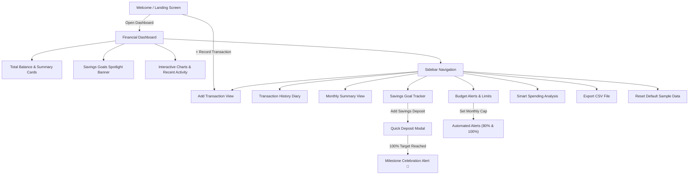

# 🌸 Personal Finance & Expense Management System — Project Documentation

---

## 1. Executive Summary & Context

### What is this project?
The **Personal Finance & Expense Management System** is a lightweight, framework-free personal budgeting and financial health application. It combines an **aesthetic, Pinterest-inspired pastel lifestyle budgeting UI** with a robust **pure Java backend** implementing core Computer Science and Object-Oriented Programming (OOP) fundamentals.

### Primary Motivations & Objectives:
1. **Academic & Viva-Ready Core Java Demonstration**:
   - Built from scratch without heavy enterprise frameworks (No Spring Boot, No Hibernate, No MySQL).
   - Demonstrates fundamental **Java OOP principles** (Encapsulation, Inheritance, Polymorphism, Abstraction), **Collections Framework** (`ArrayList`, `HashMap`), and **Java File Handling** (`BufferedReader`, `BufferedWriter`, `FileReader`, `FileWriter`).
2. **Modern & Aesthetic Lifestyle User Experience**:
   - Designed around a pastel lifestyle aesthetic (soft blush pink, baby pink, lavender, sweet peach, and warm cream).
   - Clean, rounded cards with soft colored shadows, motivational quotes, and smooth micro-interactions.
3. **Dual-Mode Deployment Architecture**:
   - **Local Environment**: Runs via a native Java HTTP Server reading and writing to delimited text files (`transactions.txt`, `budgets.txt`, `goals.txt`).
   - **Cloud / Portfolio Demo (Vercel & GitHub Pages)**: An intelligent client-side storage adapter seamlessly runs all features (calculations, charts, budget alerts, and savings deposits) using browser `localStorage` when no Java backend is detected.

---

## 2. Complete Tech Stack

| Layer | Technology | Details / Implementation |
| :--- | :--- | :--- |
| **Backend Language** | **Java (JDK 21 / 25)** | Core business logic, mathematical calculations, and OOP class hierarchy. |
| **Backend Server** | **`com.sun.net.httpserver.HttpServer`** | Built-in lightweight Java HTTP server; serves static files and REST JSON endpoints without external dependencies. |
| **Data Storage (Local)** | **Java File I/O (`.txt`)** | Delimited flat-file persistence using `BufferedReader`, `BufferedWriter`, `FileReader`, and `FileWriter`. |
| **Data Storage (Cloud)** | **HTML5 `localStorage`** | In-browser client database enabling 1-click zero-backend cloud deployments on Vercel & GitHub Pages. |
| **Frontend Markup** | **HTML5 Semantic Elements** | Responsive layout (`<aside>`, `<main>`, `<section>`, `<header>`, `<canvas>`). |
| **Frontend Styling** | **Modern Vanilla CSS3** | CSS variables, Flexbox, CSS Grid, Glassmorphism, animations, and 5 pastel color themes. |
| **Typography** | **Google Fonts** | **Poppins** (headings, metric values, buttons) & **Nunito** (body text, notes, forms). |
| **Client Scripting** | **Vanilla JavaScript (ES6+)** | Asynchronous `fetch` calls, dynamic DOM manipulation, real-time filtering, and reactive UI state. |
| **Data Visualization** | **Chart.js (CDN) + HTML5 Canvas** | Interactive Spending Breakdown Pie Chart, Cash Flow Bar Chart, and Category Donut Chart. |

---

## 3. Object-Oriented Programming (OOP) Architecture

The backend code inside [`src/`](src/) is structured specifically to showcase the four fundamental OOP principles:

```
                  ┌────────────────────────┐
                  │ Transaction (Abstract) │
                  └───────────┬────────────┘
                              │ extends
               ┌──────────────┴──────────────┐
               ▼                             ▼
       ┌───────────────┐             ┌───────────────┐
       │ Income.java   │             │ Expense.java  │
       └───────────────┘             └───────────────┘
```

### 1. Encapsulation
- **Where**: Implemented in [`src/Transaction.java`](src/Transaction.java), [`src/Income.java`](src/Income.java), [`src/Expense.java`](src/Expense.java), [`src/Budget.java`](src/Budget.java), and [`src/SavingsGoal.java`](src/SavingsGoal.java).
- **How**: All class variables (`id`, `title`, `amount`, `category`, `date`, `notes`, `source`, `paymentMethod`, `limitAmount`, `targetAmount`, `savedAmount`) are declared with `private` or `protected` access modifiers. 
- Public `getter` and `setter` methods provide controlled, validated read and write access to these variables.

### 2. Inheritance & Polymorphism
- **Parent Class**: `Transaction` defines base attributes shared by all financial records.
- **Derived Classes**:
  - `Income` extends `Transaction` and introduces the `source` field.
  - `Expense` extends `Transaction` and introduces the `paymentMethod` field.
- **Polymorphism**: The abstract method `public abstract String getSpecificDetail()` is overridden in both child classes, and polymorphism is utilized when iterating over collections of `Transaction` objects.

### 3. Collections Framework ([`src/FinanceManager.java`](src/FinanceManager.java))
- **`ArrayList<Transaction>`**: Dynamic in-memory list holding all transactions for filtering, sorting, and reporting.
- **`ArrayList<SavingsGoal>`**: Manages milestone objects, tracks progress percentages, and verifies deposit updates.
- **`HashMap<String, Double>`**:
  - Calculates category expense totals (`Food` &rarr; `$220.00`, `Shopping` &rarr; `$120.00`).
  - Calculates monthly historical summaries (`2026-11` &rarr; `$634.99`).
  - Maps category budget caps (`Food` &rarr; `$275.00`).

### 4. File Handling & Persistence ([`src/FileManager.java`](src/FileManager.java))
- Transactions are saved in `transactions.txt`.
- Budgets are stored in `budgets.txt`.
- Savings goals are stored in `goals.txt`.
- File reading uses `BufferedReader(new FileReader(...))` for safe line-by-line token parsing. Writing uses `BufferedWriter(new FileWriter(...))` to prevent data truncation.

---

## 4. End-to-End User Flow



### Detailed Screen-by-Screen Flow:

1. **Full-Page Landing & Welcome Screen**:
   - Introduces the platform with a lifestyle header, real-time balance metrics, and feature highlights.
   - Allows the user to select from **5 aesthetic themes** (Blush Pink, Soft Lavender, Sweet Peach, Matcha Mint, and Velvet Midnight).
   - A prominent button (*"Enter Dashboard →"*) transitions into the workspace.

2. **Dashboard Overview ("Hello, Sunshine! ♡")**:
   - **Motivational Quote**: *"Small steps every day lead to big dreams ♡ 🌸"*.
   - **Key Metrics**: Total Balance (Surplus/Deficit status), Total Income, Total Expenses, and Overall Savings Rate.
   - **Active Alert Banner**: Appears automatically if any budget limit reaches warning (80%) or danger (100%) thresholds.
   - **Visual Snapshot**: Category donut chart and monthly cash flow trends.
   - **Recent Activity**: Quick preview table of the 5 most recent transactions.

3. **Add Transaction View**:
   - Toggle between **Expense** (▼) and **Income** (▲).
   - Form inputs: Title/Description, Amount, Category (dynamically updates options based on Income vs. Expense), Date, Payment Method / Source, and Optional Notes.
   - Validates values and immediately updates the live ledger, balance cards, and analytics.

4. **Transaction Diary (History)**:
   - Real-time search bar (searches titles, notes, and payment methods).
   - Filter dropdowns by **Type** (All, Income, Expense) and **Category**.
   - Action buttons to **Edit** or **Delete** existing transactions.

5. **Monthly & Category Summary**:
   - Table aggregating expenses by month (`YYYY-MM`).
   - Breakdown table showing exact expenditure per category alongside its percentage of the total budget.

6. **Budget Guardrails & Alert System**:
   - Form to set custom spending limits for `Overall`, `Food`, `Shopping`, `Travel`, `Education`, `Bills`, or `Other`.
   - Live cards showing: Spent amount, Remaining amount, and Progress Bar.
   - Automated Alert Levels:
     - 🟢 **On Track** (`< 80%`)
     - 🟡 **Warning** (`80% - 99%`)
     - 🔴 **Exceeded** (`≥ 100%`)

7. **Savings Goal Tracker**:
   - Displays active goals (e.g. *New Phone*, *MacBook Pro*, *Japan Trip*, *Emergency Fund*).
   - Visual progress bars, target amounts, saved amounts, and remaining values.
   - **Add Savings Button**: Opens a popup modal with quick-deposit pills (`+$25`, `+$50`, `+$100`, `+$250`) to deposit funds incrementally.
   - **Goal Achievement State**: When 100% is reached, an animated celebration badge displays: *"Congratulations! You achieved your savings goal! 🎉"*.

8. **Smart Spending Analysis**:
   - 4 KPI summary cards (Total Monthly Expenses, Highest Spending Category, Lowest Spending Category, Active Categories).
   - **Chart.js Pie Chart**: Displays interactive percentage breakdown by category.
   - **Chart.js Bar Chart**: Compares income vs. expense cash flow across months.
   - **Automated Suggestions**: Rule-based advice (e.g., *"You spent the most on Food this month"*, *"Shopping is high at $120.00"*, *"Great 88% savings rate"*).

9. **Data Utility Actions**:
   - **Export CSV**: Generates a standard `.csv` file download of all transaction records.
   - **Reset Sample**: Restores the default demonstration records with one click.

---

## 5. Key System Components Breakdown

### A. Backend Components ([`src/`](src/))

1. **`Main.java` (Server & Router)**:
   - Sets up `HttpServer.create(new InetSocketAddress(8080), 0)`.
   - Maps REST endpoints:
     - `GET /api/summary`: Full financial state aggregation.
     - `GET, POST, DELETE /api/transactions`: Transaction CRUD operations.
     - `GET, POST /api/budgets`: Budget limit configurations.
     - `GET, POST, DELETE /api/goals`: Savings goal milestones & deposits.
     - `GET /api/analysis`: Category distribution and suggestions.
     - `GET /api/export`: Generates downloadable CSV content.
     - `POST /api/reset`: Resets seed data.
   - Serves static frontend files (`index.html`, `style.css`, `script.js`).
   - Includes a regex-based JSON parser (`parseSimpleJson`) to parse payloads without external libraries.

2. **`FinanceManager.java` (Business Logic Engine)**:
   - In-memory controller managing the `ArrayList<Transaction>` and `ArrayList<SavingsGoal>`.
   - Contains logic for computing balances, savings ratios, budget threshold warnings, and highest/lowest spending categories.

3. **`FileManager.java` (Persistence Layer)**:
   - Encapsulates flat-file reading and writing logic.
   - Seeds default sample data if the text files are absent on first run.

---

### B. Frontend Components ([`web/`](web/))

1. **`index.html` (Single-Page App View)**:
   - Structured into modular views (`section-dashboard`, `section-add`, `section-history`, `section-summary`, `section-budgets`, `section-goals`, `section-analysis`).
   - Contains accessible dialog modals for goal creation and quick deposits.

2. **`style.css` (Aesthetic Lifestyle Design System)**:
   - Implements CSS custom properties (`--primary`, `--bg-page`, `--card-highlight`, `--shadow-md`, `--border-color`).
   - Provides 5 distinct theme sets (`[data-theme="blush"]`, `lavender`, `peach`, `matcha`, `dark`).
   - Rounded corners (`border-radius: 22px`), pill-shaped action buttons, and animated progress bars.

3. **`script.js` (Frontend Orchestrator & Dual-Mode Adapter)**:
   - Intercepts `/api/` network requests: uses Java backend when run locally, or transparently computes and stores results in `localStorage` when hosted on Vercel or GitHub Pages.
   - Renders and updates Chart.js charts and HTML5 Canvas donuts.
   - Manages DOM state transitions, modal toggling, search filtering, and toast notifications.

---

## 6. Viva / Evaluation Highlights (Quick Answers for Examiners)

| Question | Answer Summary |
| :--- | :--- |
| **Why not use Spring Boot or MySQL?** | The objective is to demonstrate fundamental Java core competencies (OOP, Collections, and File I/O) without framework abstractions hiding how the code operates. |
| **Where is Polymorphism demonstrated?** | The abstract method `Transaction.getSpecificDetail()` is called on a collection of `Transaction` references, executing either `Income.getSpecificDetail()` or `Expense.getSpecificDetail()` at runtime. |
| **How is data persisted?** | Data is read and written to delimited flat files (`transactions.txt`, `budgets.txt`, `goals.txt`) using Java's `BufferedReader` and `BufferedWriter`. |
| **How does the budget alert work?** | When spending in any category reaches $\ge 80\%$ of its limit, status is marked `WARNING`; at $\ge 100\%$, status becomes `DANGER`, triggering visual alert banners. |
| **How can this be hosted on Vercel or GitHub Pages without Java?** | The frontend includes an intelligent client-side storage adapter in `script.js` that mirrors all Java calculations and persists state via browser `localStorage` when deployed on serverless cloud platforms. |

